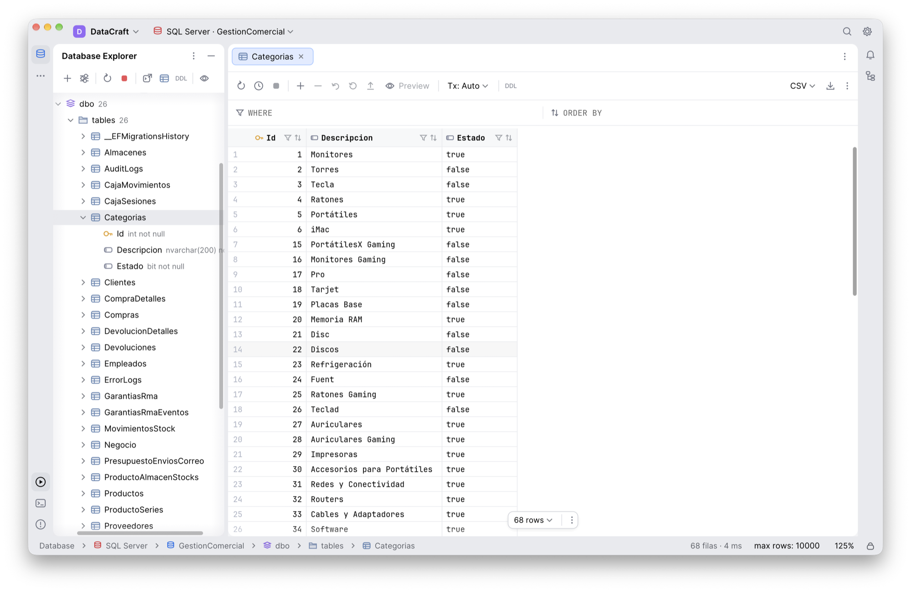

# DataCraft

DataGrip-style database client for macOS and Windows (Islands theme), written in Rust with egui.



- **Engines:** PostgreSQL, MySQL, MariaDB, SQL Server, Oracle, Snowflake and SQLite. Oracle needs the
  [Oracle Instant Client](https://www.oracle.com/database/technologies/instant-client.html) installed.
  Snowflake speaks the JDBC driver's REST protocol natively (no Java): password, key-pair (the
  `private_key_file` driver property, as in DataGrip), OAuth or programmatic access token authentication,
  with role, database, schema and warehouse per data source.
- **NoSQL:** Redis / Valkey and MongoDB. Their consoles take the engine's own commands: one Redis command per line
  (`HGETALL user:1`, `SCAN 0 MATCH user:*`…) or `mongosh` commands (`db.users.find({age: {$gt: 30}}).sort({name: 1})`,
  `aggregate`, `insertOne`, `updateMany`, `runCommand`, `show collections`…). The explorer shows Redis keys grouped by
  prefix, with each key's type, TTL and value, and MongoDB collections with the fields of a sample of their documents.
  Their grid is read-only, and read-only data sources only allow commands that read.
- **Database Explorer:** every database on the server (loaded on expand), schemas, tables, views, columns and primary keys.
- **Object browser:** click a database, schema, tables or views folder to browse its objects in a [list or grid](docs/object-browser.md), with a selection information pane on the right.
- **Navigation and organization:** [find loaded cells or search all tables](docs/navigation-search.md), organize objects with local groups/colors, and close tabs in bulk. Keyboard navigation keeps the active cell visible in wide tables.
Shortcuts are written with ⌘ / ⌥ (macOS); on Windows use Ctrl / Alt.

- **SQL consoles:** highlighting, autocompletion, ⌘↩ (statement under the cursor or selection) and ⌘⇧↩ (everything; `GO` batches on SQL Server). Each console runs against the database you pick.
  Reformat code (⌥⌘L), comment lines (⌘/), duplicate / delete line, find and replace, query history (⌥⌘E),
  explain plan (⇧⌘E) and cancel the running query.
- **Table data editor:** WHERE / ORDER BY filters, per-column value and text filters, in-place editing (update, insert, delete, clone rows) with a preview of the generated SQL, saved in a single transaction. Record view (⇧↩).
  [Keyboard navigation and multi-cell editing](docs/table-editor.md) include arrow keys, Shift/Ctrl selections, column selection, clipboard matrices, Tab, Ctrl+Enter, Ctrl+N and Ctrl+Delete, with optional **Save on row change** (off by default).
- **Database objects:** create (with character set and collation, or owner, encoding, template and locale on PostgreSQL), rename, truncate and drop databases and tables; import CSV / TSV files into a table; copy a table (all rows, a percentage or a `WHERE` filter) to another connection, database or schema, creating it there with the types translated between engines, and mask personal data per column on the way (fake name, email or phone, hash, keep the last 4, NULL), always the same masked value for the same real one. It can also bring the related rows through the foreign keys (a customer with its orders, their lines and products), inserted in an order that keeps the keys valid.
- **Views:** create and edit views from a dialog (name, schema, the `SELECT` in a highlighted editor and the engine's options: `OR REPLACE`, SQL Server `OR ALTER`, Oracle `FORCE`, MySQL `ALGORITHM` / `SQL SECURITY`), with the definition read from the server and a preview of the statements; renaming one replaces it. "Generate DDL" of a view shows its real definition.
- **Modify Table…:** rename the table; add, drop, rename and retype columns, change NOT NULL, defaults and the primary key; add and drop indexes. The ALTER TABLE statements for each engine are shown first, with a warning for changes that can lose data (on SQLite, changes it can't make in place rebuild the table in one transaction).
- **Users and privileges:** a "Users" (MySQL / MariaDB) or "Roles" (PostgreSQL) folder under each connection. Create, edit and drop users: password, host, authentication plugin, account lock and resource limits, global and per-database privileges; PostgreSQL role attributes, memberships and privileges on databases, schemas and tables. The editor previews the `CREATE` / `ALTER` / `GRANT` / `REVOKE` statements it will run, with the password masked. Inspired by the user editor of [DBCraft](https://github.com/DarkSoe/DBCraft) by DarkSoe.
- **Read-only data sources:** only queries run; editing and DDL are disabled.
- **Export:** results to CSV, TSV, JSON, SQL `INSERT`s or Markdown, to the clipboard or a file, optionally with masked columns (the same rules as the table copy).
- **Zoom:** IDE zoom (⌘+ / ⌘− / ⌘0) and editor font size (⌥⌘+ / ⌥⌘−).
- **Native macOS menu bar** with the usual shortcuts (on Windows, the same keyboard shortcuts).
- **Languages:** English, Spanish, French, Portuguese (Brazil), German, Polish, Simplified Chinese and Japanese; follows the system language and can be changed in Settings. Translations live in `locales/<code>.json` (one file per language, keyed by the English text), so adding or fixing one needs no Rust.
- **Passwords:** stored in the macOS Keychain or the Windows Credential Manager, never in the connections file.


## Download

Get the latest version from [Releases](https://github.com/javy-fernandez/datacraft/releases):

- **macOS:** `DataCraft-<version>-universal.dmg` (Apple Silicon and Intel, macOS 11+). Open it and drag
  DataCraft to Applications. The app is not notarized: the first time, right-click DataCraft.app → **Open**,
  or run `xattr -dr com.apple.quarantine /Applications/DataCraft.app`.
- **Windows:** `DataCraft-<version>-windows-x64.zip` (Windows 10/11, x64) or `DataCraft-<version>-windows-arm64.zip`
  (Windows on ARM: Snapdragon / Copilot+ PCs). Unzip it and run `DataCraft.exe`;
  no installer needed. The exe is not signed, so SmartScreen may warn the first time: **More info → Run anyway**.

## Build

```bash
cargo run                                  # development
scripts/bundle.sh --install                # optimized DataCraft.app in /Applications
scripts/bundle.sh --universal --dmg        # universal app + .dmg (needs: rustup target add x86_64-apple-darwin)
cargo build --release --target x86_64-pc-windows-gnu   # Windows .exe from macOS (needs: rustup target add x86_64-pc-windows-gnu, brew install mingw-w64)
cargo xwin build --release --target aarch64-pc-windows-msvc   # Windows ARM64 .exe (needs: rustup target add aarch64-pc-windows-msvc, cargo install cargo-xwin, brew install llvm lld; downloads the Windows SDK and accepts Microsoft's license)
```

On Windows itself, `cargo build --release` produces `target\release\datacraft.exe`.

### Code signing (optional)

`bundle.sh` signs the app with a certificate named **DataCraft** if it exists (or the one in
`DATACRAFT_SIGN_IDENTITY`). With a stable certificate the Keychain recognizes every new build
as the same app and doesn't ask again for access to the saved passwords; without it the app is
signed ad hoc and macOS asks after every install.

To create it: open **Keychain Access → Certificate Assistant → Create a Certificate…**, name it
`DataCraft`, choose *Identity Type: Self-Signed Root* and *Certificate Type: Code Signing*, and
create it in the *login* keychain.

## Tests

```bash
cargo test
scripts/test_mssql.sh <host>   # real SQL Server (non-destructive: only #temp tables), asks for the password
```

The live tests run with `cargo test -- --ignored` and the `DATACRAFT_PG_*`, `DATACRAFT_MY_*`,
`DATACRAFT_ORA_*` and `DATACRAFT_SF_*` variables (see `src/db/postgres.rs`, `src/db/mysql.rs`,
`src/db/oracle.rs` and `src/db/snowflake.rs`), and `DATACRAFT_REDIS_PORT` / `DATACRAFT_MONGO_PORT`
for a local Redis or Valkey and MongoDB (see `src/worker.rs`).

Demo mode for screenshots: `DATACRAFT_DEMO=path.db cargo run` (see the header of `src/app.rs`).

## License

DataCraft is dual-licensed under [MIT](LICENSE-MIT) or [Apache-2.0](LICENSE-APACHE), at your option.
Bundled fonts keep their own open license (SIL OFL 1.1); see [assets/fonts/README.md](assets/fonts/README.md).

## Español

Cliente de bases de datos para macOS y Windows al estilo de DataGrip (tema Islands), escrito en Rust con egui.

- **Motores:** PostgreSQL, MySQL, MariaDB, SQL Server, Oracle, Snowflake y SQLite. Oracle requiere tener instalado el
  [Oracle Instant Client](https://www.oracle.com/database/technologies/instant-client.html).
  Snowflake usa directamente el protocolo REST del driver JDBC (sin Java): autenticación por contraseña, par de
  claves (la propiedad `private_key_file` del controlador, como en DataGrip), OAuth o token de acceso
  programático, con rol, base de datos, esquema y almacén por fuente de datos.
- **NoSQL:** Redis / Valkey y MongoDB. Sus consolas aceptan los comandos propios de cada motor: un comando de Redis por línea
  (`HGETALL user:1`, `SCAN 0 MATCH user:*`…) o comandos de `mongosh` (`db.users.find({age: {$gt: 30}}).sort({name: 1})`,
  `aggregate`, `insertOne`, `updateMany`, `runCommand`, `show collections`…). El explorador muestra las claves de Redis
  agrupadas por prefijo, con el tipo, el TTL y el valor de cada una, y las colecciones de MongoDB con los campos de una
  muestra de sus documentos. Su cuadrícula es de solo lectura, y en las fuentes de datos de solo lectura solo se permiten comandos que leen.
- **Database Explorer:** todas las bases del servidor (se cargan al expandirlas), esquemas, tablas, vistas, columnas y claves primarias.
- **Explorador de objetos:** haz clic en una base, esquema o carpeta de tablas/vistas para ver sus objetos en [lista o cuadrícula](docs/object-browser.md), con información de la selección a la derecha.
- **Navegación y organización:** [busca en las celdas cargadas o en todas las tablas](docs/navigation-search.md), organiza objetos con grupos y colores locales y cierra pestañas en bloque. La navegación por teclado mantiene visible la celda activa en tablas anchas.
Los atajos se indican con ⌘ / ⌥ (macOS); en Windows son Ctrl / Alt.

- **Consolas SQL:** resaltado, autocompletado, ⌘↩ (sentencia bajo el cursor o selección) y ⌘⇧↩ (todo; lotes `GO` en SQL Server). Cada consola ejecuta en la base que elijas.
  Formatear código (⌥⌘L), comentar líneas (⌘/), duplicar / borrar línea, buscar y reemplazar, historial de consultas (⌥⌘E),
  plan de ejecución (⇧⌘E) y cancelar la consulta en curso.
- **Editor de datos de tabla:** filtros WHERE / ORDER BY, filtros de valores y de texto por columna, edición en el sitio (modificar, insertar, borrar y clonar filas) con vista previa del SQL generado, que se guarda en una sola transacción. Vista de registro (⇧↩).
  La [navegación y edición de varias celdas](docs/table-editor.md) incluye flechas, selecciones con Shift/Ctrl, selección de columnas, matrices del portapapeles, Tab, Ctrl+Enter, Ctrl+N y Ctrl+Supr, con **Guardar al cambiar de fila** opcional (desactivado por defecto).
- **Objetos de la base:** crear (con juego de caracteres y collation, o propietario, codificación, plantilla y locale en PostgreSQL), renombrar, vaciar y eliminar bases de datos y tablas; importar ficheros CSV / TSV a una tabla; copiar una tabla (todas las filas, un porcentaje o un filtro `WHERE`) a otra conexión, base de datos o esquema, creándola allí con los tipos traducidos entre motores, y enmascarar datos personales por columna al copiar (nombre, email o teléfono falsos, hash, dejar los 4 últimos, NULL), siempre con el mismo valor enmascarado para el mismo valor real. También puede arrastrar las filas relacionadas por las claves foráneas (un cliente con sus pedidos, sus líneas y productos), insertadas en un orden que mantiene válidas las claves.
- **Vistas:** crear y editar vistas desde un diálogo (nombre, esquema, el `SELECT` en un editor con resaltado y las opciones del motor: `OR REPLACE`, `OR ALTER` en SQL Server, `FORCE` en Oracle, `ALGORITHM` / `SQL SECURITY` en MySQL), con la definición leída del servidor y vista previa de las sentencias; renombrarla la sustituye. "Generate DDL" de una vista muestra su definición real.
- **Modificar tabla…:** renombrar la tabla; añadir, eliminar, renombrar y cambiar el tipo de columnas, cambiar NOT NULL, valores por defecto y la clave primaria; añadir y eliminar índices. Antes se muestran las sentencias ALTER TABLE de cada motor, con un aviso para los cambios que pueden perder datos (en SQLite, lo que no se puede cambiar sin más reconstruye la tabla en una sola transacción).
- **Usuarios y privilegios:** una carpeta "Users" (MySQL / MariaDB) o "Roles" (PostgreSQL) en cada conexión. Crea, edita y elimina usuarios: contraseña, host, plugin de autenticación, bloqueo de cuenta y límites de recursos, privilegios globales y por base de datos; en PostgreSQL, atributos de rol, pertenencias y privilegios sobre bases, esquemas y tablas. El editor muestra antes las sentencias `CREATE` / `ALTER` / `GRANT` / `REVOKE` que ejecutará, con la contraseña oculta. Inspirado en el editor de usuarios de [DBCraft](https://github.com/DarkSoe/DBCraft), de DarkSoe.
- **Data sources de solo lectura:** solo se ejecutan consultas; la edición y el DDL quedan desactivados.
- **Exportación:** resultados a CSV, TSV, JSON, `INSERT`s SQL o Markdown, al portapapeles o a un fichero, opcionalmente con columnas enmascaradas (las mismas reglas que la copia de tablas).
- **Zoom:** zoom del IDE (⌘+ / ⌘− / ⌘0) y tamaño de fuente del editor (⌥⌘+ / ⌥⌘−).
- **Menú nativo de macOS** con los atajos habituales (en Windows, los mismos atajos de teclado).
- **Idiomas:** inglés, español, francés, portugués (Brasil), alemán, polaco, chino simplificado y japonés; sigue el idioma del sistema y se puede cambiar en Ajustes. Las traducciones están en `locales/<código>.json` (un fichero por idioma, con el texto en inglés como clave), así que añadir o corregir uno no requiere tocar Rust.
- **Contraseñas:** se guardan en el Llavero de macOS o en el Administrador de credenciales de Windows, nunca en el fichero de conexiones.

### Descarga

Descarga la última versión desde [Releases](https://github.com/javy-fernandez/datacraft/releases):

- **macOS:** `DataCraft-<versión>-universal.dmg` (Apple Silicon e Intel, macOS 11+). Ábrelo y arrastra
  DataCraft a Aplicaciones. La app no está notarizada: la primera vez, clic derecho en DataCraft.app → **Abrir**,
  o ejecuta `xattr -dr com.apple.quarantine /Applications/DataCraft.app`.
- **Windows:** `DataCraft-<versión>-windows-x64.zip` (Windows 10/11, x64) o `DataCraft-<versión>-windows-arm64.zip`
  (Windows en ARM: Snapdragon / Copilot+ PC). Descomprímelo y ejecuta `DataCraft.exe`;
  no necesita instalación. El exe no está firmado y SmartScreen puede avisar la primera vez: **Más información → Ejecutar de todas formas**.

### Compilar

```bash
cargo run                                  # desarrollo
scripts/bundle.sh --install                # DataCraft.app optimizada en /Applications
scripts/bundle.sh --universal --dmg        # app universal + .dmg (requiere: rustup target add x86_64-apple-darwin)
cargo build --release --target x86_64-pc-windows-gnu   # .exe de Windows desde macOS (requiere: rustup target add x86_64-pc-windows-gnu, brew install mingw-w64)
cargo xwin build --release --target aarch64-pc-windows-msvc   # .exe de Windows ARM64 (requiere: rustup target add aarch64-pc-windows-msvc, cargo install cargo-xwin, brew install llvm lld; descarga el SDK de Windows y acepta la licencia de Microsoft)
```

En el propio Windows, `cargo build --release` genera `target\release\datacraft.exe`.

**Firma (opcional):** `bundle.sh` firma la app con un certificado llamado **DataCraft** si existe
(o con el de `DATACRAFT_SIGN_IDENTITY`). Con un certificado estable el Llavero reconoce cada
compilación nueva como la misma app y no vuelve a pedir acceso a las contraseñas guardadas; sin
él la firma es ad hoc y macOS lo pide tras cada instalación.

Para crearlo: abre **Acceso a Llaveros → Asistente de certificados → Crear un certificado…**,
llámalo `DataCraft`, elige *Tipo de identidad: Raíz autofirmada* y *Tipo de certificado: Firma de
código*, y créalo en el llavero *inicio de sesión*.

### Tests

```bash
cargo test
scripts/test_mssql.sh <host>   # SQL Server real (no destructivo: solo tablas #temp), pide la contraseña
```

Los tests en vivo se ejecutan con `cargo test -- --ignored` y las variables `DATACRAFT_PG_*`,
`DATACRAFT_MY_*`, `DATACRAFT_ORA_*` y `DATACRAFT_SF_*` (ver `src/db/postgres.rs`, `src/db/mysql.rs`,
`src/db/oracle.rs` y `src/db/snowflake.rs`), y `DATACRAFT_REDIS_PORT` / `DATACRAFT_MONGO_PORT`
para un Redis o Valkey y un MongoDB locales (ver `src/worker.rs`).

Modo demo para capturas: `DATACRAFT_DEMO=ruta.db cargo run` (ver la cabecera de `src/app.rs`).

### Licencia

DataCraft tiene doble licencia [MIT](LICENSE-MIT) o [Apache-2.0](LICENSE-APACHE), a tu elección.
Las fuentes incluidas mantienen su propia licencia abierta (SIL OFL 1.1); ver [assets/fonts/README.md](assets/fonts/README.md).
